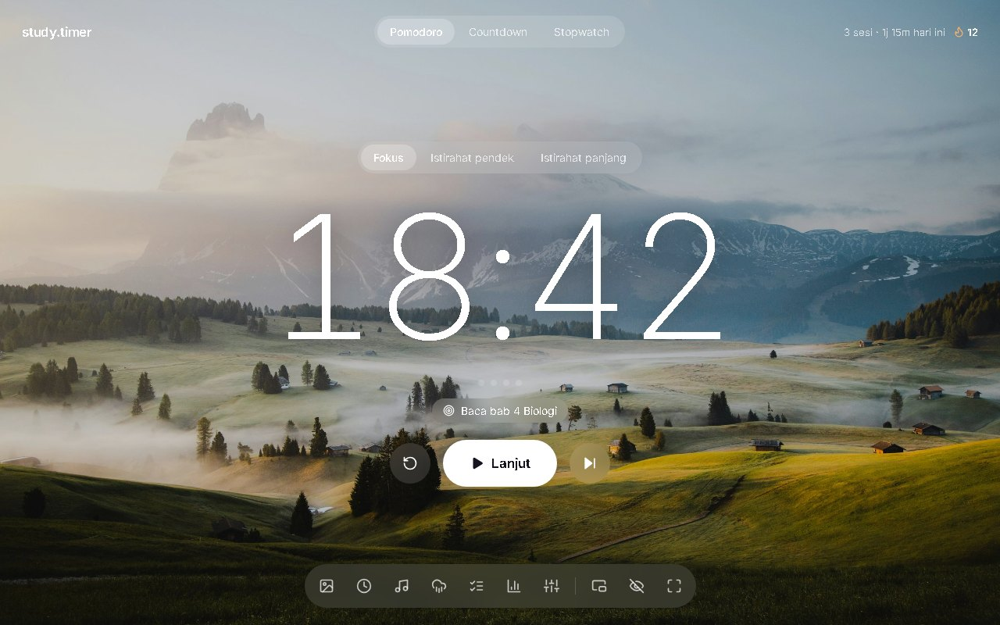
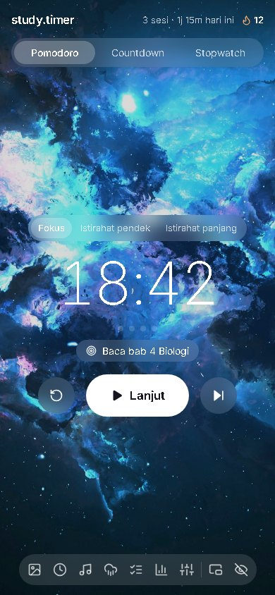
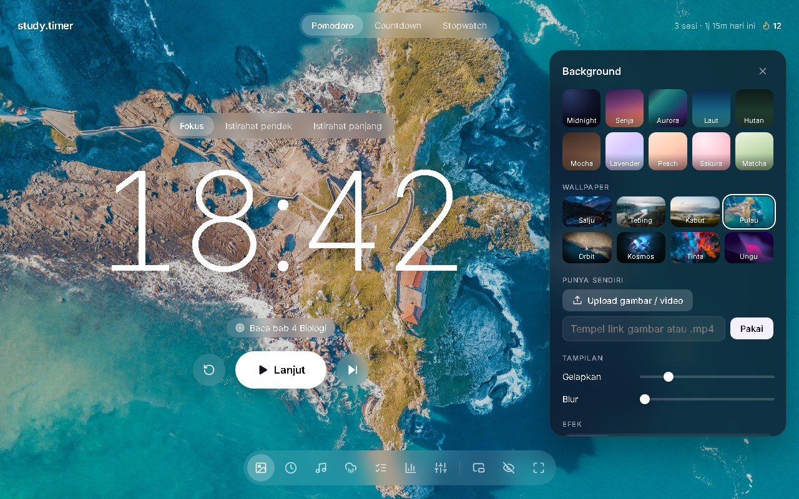
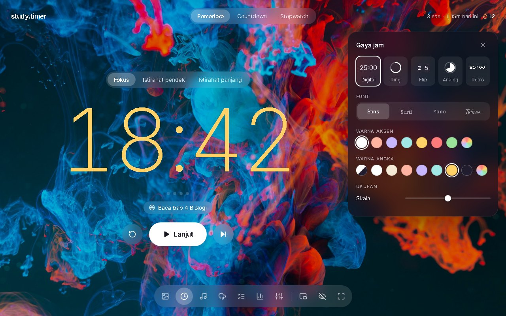
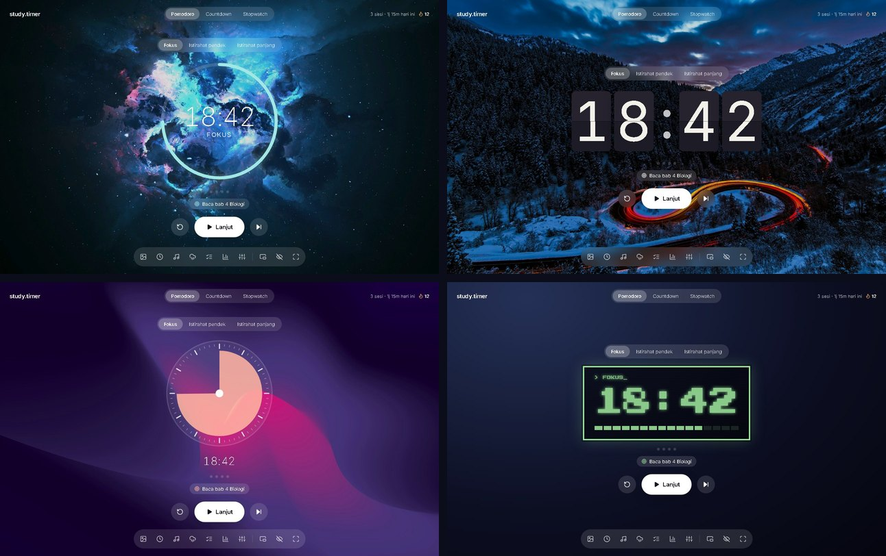
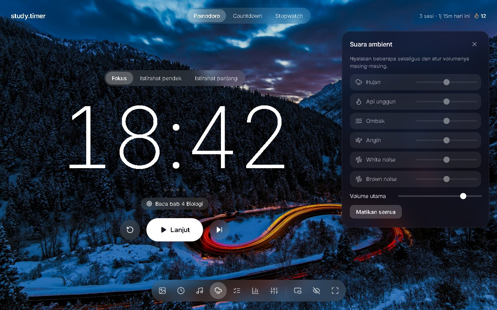
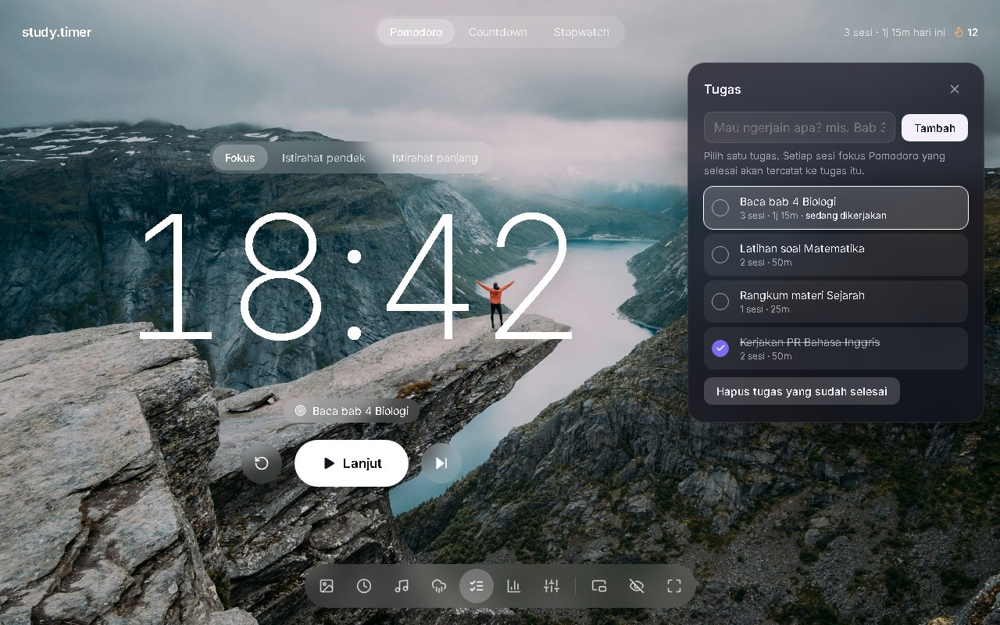
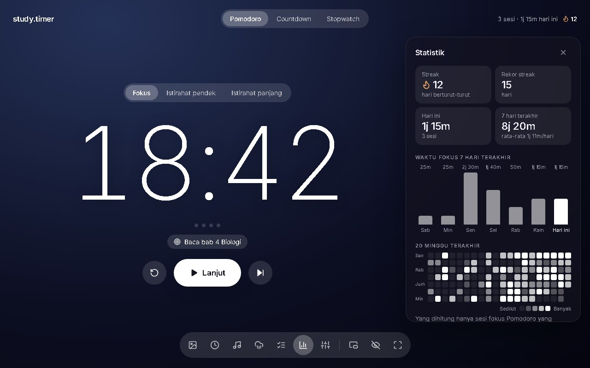
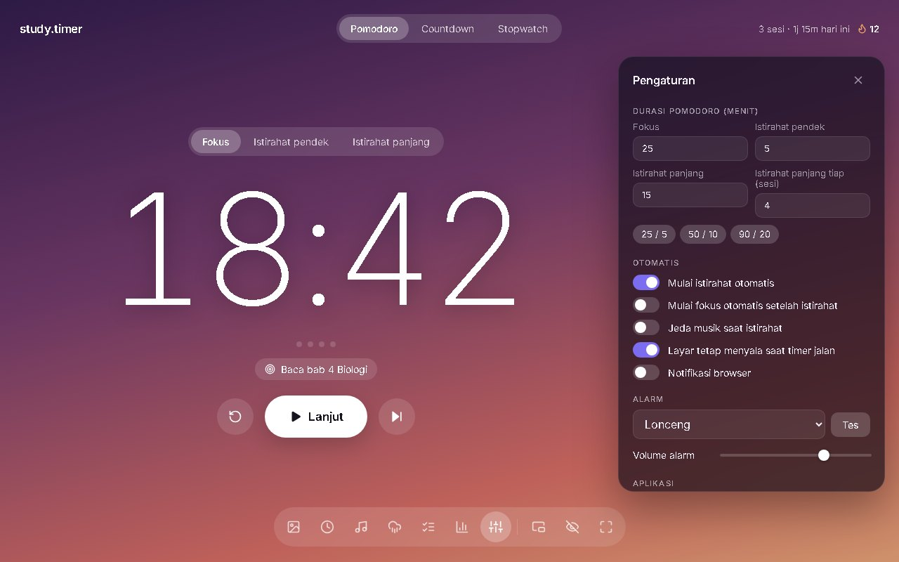

# It's Study Time ⏱️

Study timer yang enak dilihat. Ada Pomodoro, countdown, stopwatch, dan jam, ditambah wallpaper, musik, suara ambient, daftar tugas, dan statistik belajar. Semuanya jalan di browser, tanpa akun dan tanpa install apa pun selain Python. Kalau mau, bisa juga di-install jadi aplikasi di laptop.



## Daftar isi

- [Fitur](#fitur)
- [Cara menjalankan](#cara-menjalankan)
- [Install sebagai aplikasi](#install-sebagai-aplikasi)
- [Tutorial](#tutorial)
  - [1. Pilih mode timer](#1-pilih-mode-timer)
  - [2. Ganti background dan wallpaper](#2-ganti-background-dan-wallpaper)
  - [3. Atur gaya jam](#3-atur-gaya-jam)
  - [4. Putar musik](#4-putar-musik)
  - [5. Nyalakan suara ambient](#5-nyalakan-suara-ambient)
  - [6. Catat tugas](#6-catat-tugas)
  - [7. Lihat statistik dan streak](#7-lihat-statistik-dan-streak)
  - [8. Pengaturan](#8-pengaturan)
  - [9. Jendela mini, mode fokus, layar penuh](#9-jendela-mini-mode-fokus-layar-penuh)
- [Shortcut keyboard](#shortcut-keyboard)
- [Pertanyaan umum](#pertanyaan-umum)
- [Struktur folder](#struktur-folder)
- [Kredit](#kredit)

## Fitur

- **4 mode**: Pomodoro (fokus, istirahat pendek, istirahat panjang), Countdown, Stopwatch, dan Jam (waktu sekarang + tanggal). Pindah mode tidak me-reset waktu yang sedang berjalan.
- **5 gaya jam**: Digital, Ring, Flip (kartu yang benar-benar membalik), Analog, dan Retro.
- **Background**: 10 gradient, 8 wallpaper foto, atau gambar/video milikmu sendiri. Bisa ditambah efek hujan, salju, atau kunang-kunang.
- **Warna bisa diatur**: warna aksen dan warna angka jam dipilih terpisah.
- **Musik**: radio YouTube (lofi, synthwave, musik tidur), link YouTube sendiri, atau file musik dari laptop.
- **Suara ambient**: hujan, api unggun, ombak, angin, white noise, brown noise. Bisa dicampur.
- **Daftar tugas**: setiap sesi fokus yang selesai tercatat ke tugas yang sedang dikerjakan.
- **Statistik**: streak harian, waktu fokus 7 hari terakhir, dan heatmap 20 minggu.
- **Jendela mini** yang mengambang di atas aplikasi lain.
- **Bisa di-install** dan tetap jalan tanpa internet.
- **Tampilan HP** juga rapi.

<p align="center"></p>

## Cara menjalankan

Yang dibutuhkan: browser **Chrome** atau **Edge**, dan **Python 3** (atau Node.js).

### Windows

1. Download project ini: klik **Code → Download ZIP** lalu ekstrak, atau clone:
   ```bash
   git clone https://github.com/MuhammadMirzaRalfie/Its-Study-Time.git
   ```
2. Buka foldernya, lalu **double-click `start.bat`**.
3. Browser otomatis terbuka di **http://localhost:5500**. Selesai!

Biarkan jendela hitam (server) tetap terbuka selama memakai Study Timer. Tutup jendela itu untuk mematikannya.

### Mac / Linux

```bash
cd Its-Study-Time
python3 -m http.server 5500
```

Lalu buka **http://localhost:5500** di browser.

> **Kenapa harus lewat server, tidak langsung buka `index.html`?**
> Sebagian besar fitur tetap jalan kalau `index.html` dibuka langsung. Tapi musik YouTube, fitur install, dan mode offline butuh halaman dibuka lewat `http://`, bukan `file://`.

## Install sebagai aplikasi

Setelah di-install, Study Timer punya ikon sendiri di Start Menu/taskbar, terbuka di jendelanya sendiri, dan **tetap bisa dibuka tanpa menjalankan `start.bat` lagi**.

1. Jalankan `start.bat` dan buka http://localhost:5500 di Chrome atau Edge.
2. Klik ikon ⚙️ **Pengaturan** di dock bawah, lalu di bagian **Aplikasi** klik **Install Study Timer**.
   Bisa juga lewat ikon install di ujung kanan address bar.
3. Cari **Study Timer** di Start Menu, lalu pin ke taskbar kalau mau.

Catatan:
- Musik YouTube tetap butuh internet. Fitur lain jalan offline.
- Selama `start.bat` jalan, aplikasi selalu memakai versi file terbaru. Kalau server mati, aplikasi memakai versi terakhir yang tersimpan.

## Tutorial

Semua menu ada di **dock** bagian bawah layar. Dari kiri ke kanan:

| Ikon | Fungsi |
|------|--------|
| 🖼️ | Background |
| 🕒 | Gaya jam |
| 🎵 | Musik |
| 🌧️ | Suara ambient |
| ☑️ | Tugas |
| 📊 | Statistik |
| ⚙️ | Pengaturan |
| ⧉ | Jendela mini |
| 👁️ | Mode fokus |
| ⛶ | Layar penuh |

Klik ikon sekali untuk membuka panelnya, klik lagi (atau tekan `Esc`) untuk menutup.

### 1. Pilih mode timer

Pilih mode di bagian atas tengah:

- **Pomodoro**: siklus fokus dan istirahat. Default-nya fokus 25 menit, istirahat pendek 5 menit, dan istirahat panjang 15 menit setiap 4 sesi. Titik-titik di bawah jam menunjukkan sudah berapa sesi selesai di siklus ini.
- **Countdown**: hitung mundur biasa. Pilih durasi cepat atau isi sendiri berapa menit.
- **Stopwatch**: hitung maju.
- **Jam**: menampilkan waktu sekarang (format 24 jam) dan tanggal, dengan gaya jam pilihanmu. Cocok jadi jam meja, misalnya flip clock + mode fokus.

Lalu tekan **Mulai** (atau `Space`). Tombol ↺ untuk reset, ⏭ untuk lewati sesi.

Waktu tiap mode disimpan masing-masing. Misalnya Pomodoro sedang di 18:42 lalu kamu pindah ke Stopwatch, timer dijeda, dan saat kembali ke Pomodoro waktunya masih 18:42.

### 2. Ganti background dan wallpaper

Klik 🖼️ **Background**.



- **Baris atas**: 10 gradient warna. *Aurora* bergerak pelan.
- **Wallpaper**: 8 foto pemandangan dan abstrak.
- **Punya sendiri**: upload gambar atau video (mp4/webm) dari laptop, atau tempel link gambar dari internet. File yang di-upload disimpan di browser, jadi tetap ada setelah aplikasi ditutup.
- **Tampilan**: *Gelapkan* membuat background lebih gelap supaya angka lebih terbaca. *Blur* membuat background buram.
- **Efek**: hujan, salju, atau kunang-kunang di atas background.
- **Warna teks**: *Otomatis* memilih teks putih atau gelap sesuai terang-gelapnya background.

### 3. Atur gaya jam

Klik 🕒 **Gaya jam**.



- **Gaya**: Digital, Ring, Flip, Analog, atau Retro.
- **Font**: Sans, Serif, Mono, atau Tulisan tangan.
- **Warna aksen**: warna ring, jarum analog, titik sesi, dan grafik statistik.
- **Warna angka**: warna angka jam, terpisah dari warna aksen. *Otomatis* mengikuti warna teks. Ikon pelangi untuk memilih warna apa saja.
- **Ukuran**: perbesar atau perkecil jam.

Contoh empat gaya jam (Ring, Flip, Analog, Retro):



### 4. Putar musik

Klik 🎵 **Musik**.

- **YouTube**: pilih salah satu dari 4 stasiun (Lofi hip hop, Synthwave, Lofi house, Deep sleep), atau tempel link video/playlist YouTube lalu klik **Putar**.
- **File lokal**: klik **Pilih file musik** dan pilih satu atau beberapa lagu dari laptop. Lagu hanya diputar di browser dan tidak diunggah ke mana pun.

Di **Pengaturan** ada opsi *Jeda musik saat istirahat* kalau musiknya hanya mau diputar selama fokus.

### 5. Nyalakan suara ambient

Klik 🌧️ **Suara ambient**.



Klik nama suara untuk menyalakan/mematikan, dan geser slidernya untuk volume. Beberapa suara bisa dinyalakan sekaligus, misalnya hujan + api unggun. Suaranya dibuat langsung di browser, jadi tidak perlu internet.

### 6. Catat tugas

Klik ☑️ **Tugas**.



1. Tulis tugas, misalnya "Baca bab 4 Biologi", lalu klik **Tambah**.
2. Klik tugas untuk memilihnya sebagai tugas yang sedang dikerjakan. Namanya muncul di bawah jam.
3. Setiap sesi fokus Pomodoro yang selesai otomatis tercatat ke tugas itu (jumlah sesi dan total waktunya).
4. Centang lingkaran di kiri kalau tugas sudah selesai. Tugas yang selesai bisa dihapus sekaligus.

Bisa juga klik nama tugas di bawah jam untuk langsung membuka panel ini.

### 7. Lihat statistik dan streak

Klik 📊 **Statistik**, atau klik tulisan "x sesi hari ini 🔥" di kanan atas.



- **Streak**: berapa hari berturut-turut kamu menyelesaikan minimal satu sesi fokus. Hari ini belum belajar tidak langsung memutus streak, asal kemarin ada sesi.
- **Rekor streak**: streak terpanjang yang pernah dicapai.
- **Grafik 7 hari** dan **heatmap 20 minggu**: makin terang kotaknya, makin lama kamu fokus di hari itu. Arahkan mouse ke kotak atau batang untuk melihat detailnya.

Yang dihitung hanya sesi fokus Pomodoro yang berjalan sampai habis, bukan yang di-skip.

### 8. Pengaturan

Klik ⚙️ **Pengaturan**.



- **Durasi Pomodoro**: atur sendiri, atau pakai preset 25/5, 50/10, 90/20.
- **Otomatis**: mulai istirahat/fokus otomatis, jeda musik saat istirahat, layar tetap menyala selama timer jalan, dan notifikasi browser saat sesi selesai.
- **Alarm**: pilih bunyi alarm, klik **Tes** untuk mendengarnya, dan atur volumenya.
- **Aplikasi**: tombol install (lihat [Install sebagai aplikasi](#install-sebagai-aplikasi)).
- **Kembalikan pengaturan awal**: reset semua pengaturan. Riwayat belajar dan tugas tidak ikut terhapus.

### 9. Jendela mini, mode fokus, layar penuh

- **⧉ Jendela mini** (`P`): membuka timer kecil yang selalu tampil di atas aplikasi lain, cocok saat belajar sambil membuka PDF atau Word. Ada tombol mulai/jeda, reset, dan lewati. Hanya tersedia di Chrome dan Edge versi baru.
- **👁️ Mode fokus** (`H`): menyembunyikan semua tombol, hanya jam yang terlihat. Tekan `H` atau `Esc` untuk keluar.
- **⛶ Layar penuh** (`F`).

## Shortcut keyboard

| Tombol | Fungsi |
|--------|--------|
| `Space` | Mulai / jeda |
| `R` | Reset |
| `S` | Lewati sesi |
| `H` | Mode fokus |
| `F` | Layar penuh |
| `P` | Jendela mini |
| `Esc` | Tutup panel |

## Pertanyaan umum

**Data saya disimpan di mana?**
Semua pengaturan, tugas, dan riwayat disimpan di browser kamu sendiri (localStorage dan IndexedDB). Tidak ada yang dikirim ke server mana pun. Artinya data tidak pindah otomatis ke browser atau laptop lain.

**Kenapa data saya hilang?**
Data terikat ke alamat yang dipakai. `http://localhost:5500` dan `file:///.../index.html` dianggap tempat berbeda oleh browser, jadi datanya juga terpisah. Pakai alamat yang sama setiap kali. Menghapus data situs/cache browser juga akan menghapusnya.

**Musik YouTube tidak mau diputar.**
Pastikan halaman dibuka lewat http://localhost:5500 (jalankan `start.bat`), bukan dengan double-click `index.html`, dan ada koneksi internet.

**Port 5500 sudah dipakai program lain.**
Misalnya Live Server di VS Code. Tutup program itu dulu, atau jalankan server di port lain, misalnya `python -m http.server 5600`. Ingat, port berbeda berarti data juga berbeda (lihat di atas).

**Perubahan kode tidak muncul.**
Tekan `Ctrl + F5` untuk reload penuh.

**Cara menambah wallpaper sendiri ke daftar bawaan?**
1. Taruh gambarnya di folder `backgrounds/`, misalnya `pantai.jpg` (ukuran sekitar 2560 px sudah cukup).
2. Buat versi kecilnya (sekitar 360 px) dengan nama yang sama di `backgrounds/thumbs/`.
3. Tambahkan satu baris di daftar `WALLPAPERS` di `js/media.js`:
   ```js
   { id: 'wp-pantai', name: 'Pantai', css: '#3a6f8f' },
   ```
   `id` harus `wp-` + nama file tanpa `.jpg`. `css` adalah warna yang tampil selama gambar dimuat.

Kalau cuma mau pakai gambar sendiri tanpa mengubah kode, pakai saja tombol **Upload** di panel Background.

## Struktur folder

```
├── index.html          Halaman utama
├── style.css           Semua tampilan
├── js/
│   ├── util.js         Helper, penyimpanan, ikon
│   ├── audio.js        Alarm dan suara ambient
│   ├── clock.js        5 gaya jam (termasuk animasi flip)
│   ├── media.js        Background, efek partikel, musik
│   ├── progress.js     Riwayat, streak, tugas, statistik
│   ├── pip.js          Jendela mini
│   └── app.js          Logika timer dan penghubung semuanya
├── backgrounds/        Wallpaper bawaan (+ thumbs/ untuk pilihan di panel)
├── icons/              Ikon aplikasi
├── manifest.json       Info aplikasi untuk install
├── sw.js               Service worker (mode offline)
├── start.bat           Menjalankan server lokal di Windows
└── docs/screenshots/   Gambar untuk README ini
```

Dibuat dengan HTML, CSS, dan JavaScript biasa, tanpa framework dan tanpa build step.

## Kredit

Foto wallpaper dari [Unsplash](https://unsplash.com):

| Wallpaper | Fotografer |
|-----------|-----------|
| Salju | [Alexander Slattery](https://unsplash.com/photos/LI748t0BK8w) |
| Tebing | [Benjamin Davies](https://unsplash.com/photos/P9BY2joAcwk) |
| Tinta | [Lucas K](https://unsplash.com/photos/wQLAGv4_OYs) |
| Ungu | [Milad Fakurian](https://unsplash.com/photos/nY14Fs8pxT8) |
| Orbit | [SpaceX](https://unsplash.com/photos/VBNb52J8Trk) |
| Kabut | [Taneli Lahtinen](https://unsplash.com/photos/suSwPNTaQ5Q) |
| Pulau | [Willian Justen de Vasconcellos](https://unsplash.com/photos/7kCNXfo35aU) |

Font dari [Google Fonts](https://fonts.google.com): Inter, Playfair Display, JetBrains Mono, Caveat, Press Start 2P.
